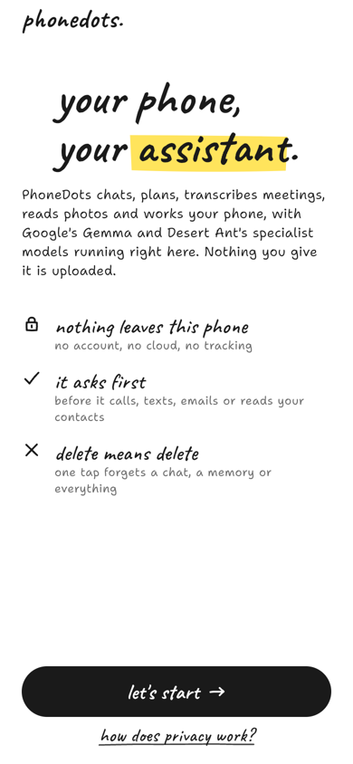
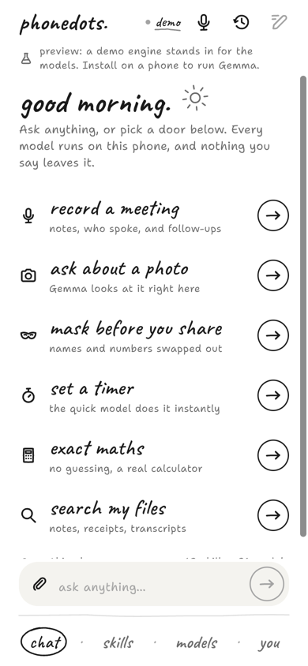
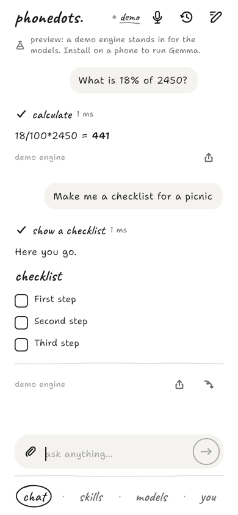
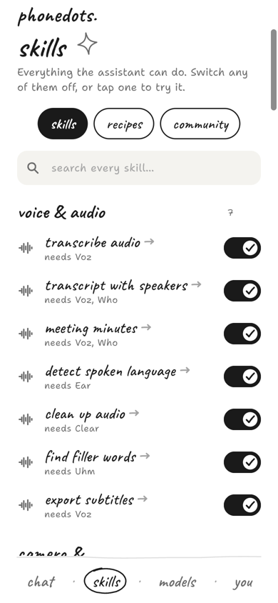
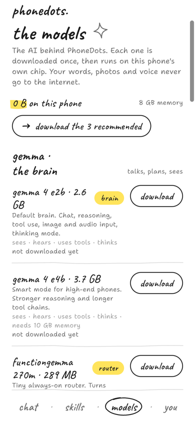
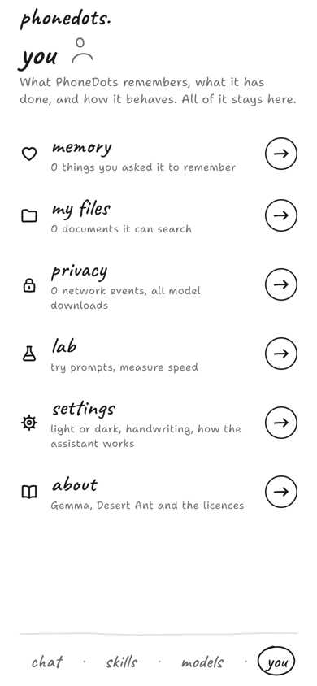
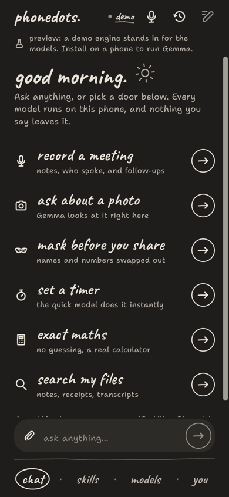
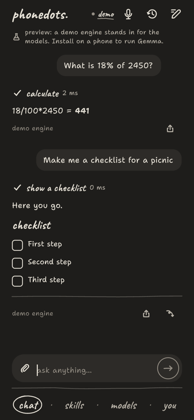

# PhoneDots

**An AI assistant that runs entirely on your phone.** Google's Gemma models are the brain, Desert Ant's specialist models are the hands, and *skills* connect them to your phone, your files and each other. No account, no cloud, and it works in airplane mode.

Flutter app for Android and iOS, with native bridges to [LiteRT-LM](https://github.com/google-ai-edge/LiteRT-LM) and [desert-ant-core](https://github.com/Desert-Ant-Labs/desert-ant-core). Inspired by [Google AI Edge Gallery](https://github.com/google-ai-edge/gallery).

<p>




</p>
<p>




</p>

*Screenshots from the web preview, which runs the demo engine.*

## Look and feel

PhoneDots uses **Burrow's "hand-drawn minimal" design system** (from [Android-Showcase](https://github.com/Shashank2577/Android-Showcase), `design/burrow-a/theme`), ported to Flutter so both apps feel like one family:

- White paper and ink (a warm "night notebook" in dark mode), with one marker-yellow swipe per screen and red pen only for destructive things.
- Caveat hand-lettering for headings over a quieter body voice you choose in settings (formal, friendly, neat hand, loose hand or all handwritten).
- No cards: content sits on the paper, separated by wobbly hairlines. Pages open with a name and a one-line purpose; "doors" with circled arrows lead somewhere; the bottom bar is four words with a drawn ring.
- Burrow's doodle icon set, ink-pill primary buttons, outlined pills, drawn switches with a tick, and visible buttons instead of hidden gestures.
- Calm motion: a light squish and haptic tick on press, rows rising in as they scroll into view, the nav ring drawing itself, ticks drawing on.

Tokens, fonts and components live in `lib/theme/theme.dart` and `lib/widgets/hand.dart`.

## What it does

| | |
|---|---|
| **Chat** | Gemma 4 E2B/E4B with streaming, thinking mode, images and short audio clips as input |
| **Agent** | Gemma plans and calls skills in a bounded loop. FunctionGemma 270M is a fast path for simple phone commands. |
| **58 skills** | Audio (transcribe, speakers, minutes, subtitles, clean-up), vision (ask, OCR, tags, best shot, safety, receipts), writing (summarize, rewrite, translate, redact, emoji, topics, titles), phone actions (timer, alarm, calendar, contacts, call/text/email drafts, maps, flashlight, settings), knowledge (search my files, memory, exact maths, units, dates), presentation (tables, checklists, charts, timelines, notes) |
| **Recipes** | Chain skills into one tap. Five built in, plus an editor. The agent can run them too. |
| **Community skills** | Install declarative JSON skills from a URL. They can't run code (see [docs/COMMUNITY_SKILLS.md](docs/COMMUNITY_SKILLS.md)). |
| **Voice mode** | Talk, Voz transcribes on device, the agent answers, and the reply is read aloud |
| **My files** | On-device search index (EmbeddingGemma, or keyword fallback) over notes, imports, receipts and transcripts |
| **Memory** | Facts you explicitly ask it to remember, fully visible and editable |
| **Model hub** | Downloads with resume and SHA-256 verification, RAM-fit warnings, choice of brain/router/embedder |
| **Lab** | Prompt Lab and an on-device benchmark (tok/s, time to first token) |
| **Privacy** | A ledger of every action. The only network events are model and skill downloads. |
| **Share sheet** | "Share to PhoneDots" from any app on Android (text, images, audio, video) |

## Architecture

```
Surfaces    Chat · Voice · Skills/Recipes · Models · Lab · Privacy · Share sheet
   │
Agent       lib/agent/agent.dart
            FunctionGemma router (fast path) → Gemma planner tool loop → permission gate → skills
   │
Skills      lib/skills/  built-in (audio, vision, text, phone, knowledge, output) · recipes · community
   │
Engines     lib/core/runtime/engines.dart (interfaces)
            ├─ platform_engines.dart  → MethodChannels → Kotlin / Swift bridges
            └─ demo_engines.dart      → web/desktop preview and tests (always labelled "Demo")
   │
Native      android/…/LlmBridge.kt        LiteRT-LM 0.19 (Gemma, tool calling, embeddings)
            android/…/SpecialistBridge.kt desert-ant-core 4.2.1 Android SDK
            android/…/DeviceBridge.kt     intents, calendar, contacts, torch, volume
            ios/Runner/*Bridge.swift      LiteRTLM + Desert Ant Swift packages, EventKit, Contacts
```

The channel contract is documented in [docs/NATIVE_BRIDGE.md](docs/NATIVE_BRIDGE.md). The product spec is in [docs/PRODUCT_SPEC.md](docs/PRODUCT_SPEC.md).

### Models

| Model | Role | Download |
|---|---|---|
| Gemma 4 E2B | Brain (default) | 2.6 GB, `litert-community/gemma-4-E2B-it-litert-lm` |
| Gemma 4 E4B | Brain (high-end phones) | 3.7 GB |
| FunctionGemma 270M (mobile actions) | Fast router | 289 MB |
| Gemma 3 270M | Brain for low-memory phones | 304 MB |
| EmbeddingGemma 2 (text / text+vision) | Search | 165 MB / 388 MB |
| Desert Ant: Voz, Who, Ear, Clear, Redact, Tongue, Emo, Gist, Eye, Moderator, Shapes | Specialists, Android + iOS | 1 MB – 470 MB each |
| Desert Ant: Uhm, Align, Title, Clips | Specialists, iOS only | |

Gemma files and checksums are pinned in `lib/core/models/model_catalog.dart`. The Desert Ant SDK downloads and verifies its own weights.

## Run it

Requirements: Flutter 3.47+ (Dart 3.13).

```bash
flutter pub get
```

```bash
flutter test
```

```bash
flutter run -d chrome
```

The web/desktop build runs the **demo engine**: the full UI and the skill system work, and model output is scripted and clearly labelled. Real inference needs a phone.

**Android** (API 26+, arm64; 8 GB RAM recommended for Gemma 4 E2B):

```bash
flutter run -d <android-device> --release
```

**iOS** (iOS 18+, Xcode 26): add the Swift packages once, as described in [docs/IOS_SETUP.md](docs/IOS_SETUP.md), then:

```bash
flutter run -d <iphone> --release
```

## Status

| Area | State |
|---|---|
| Dart app, agent, skills, UI | Done. `flutter analyze` is clean and 23 tests pass (unit, end-to-end agent loop, widget). |
| Android native bridge | Builds into an APK (`flutter build apk`) against LiteRT-LM 0.19.0 and desert-ant-core 4.2.1. Not yet run on a physical device. Both SDKs ship `libLiteRt.so` and the APK keeps one copy, so check on a device that Gemma and the specialists both load. If they don't, align the LiteRT versions. |
| iOS native bridge | Written against the LiteRT-LM and desert-ant-core Swift APIs. Not compiled here (needs macOS/Xcode). |
| Share extension on iOS | Not built. Android share intake works. |

## Licences

App code: see repository. Gemma models: [Gemma Terms of Use](https://ai.google.dev/gemma/terms). Desert Ant models: free up to 100k monthly active devices; Voz weights (NVIDIA Parakeet TDT 0.6B v3) under CC BY 4.0. LiteRT-LM and Edge Gallery: Apache 2.0.
