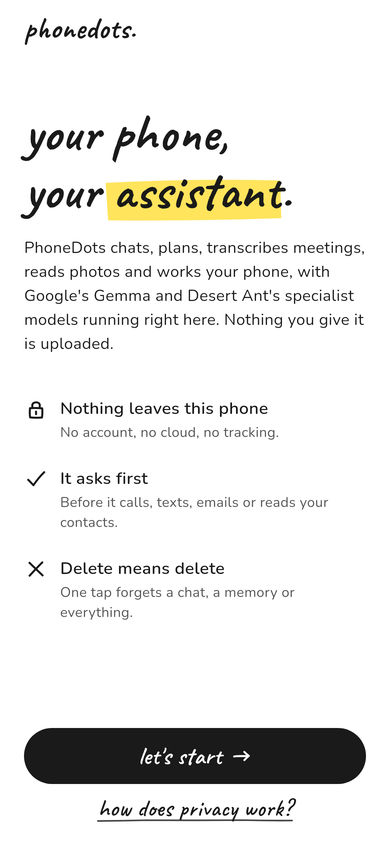
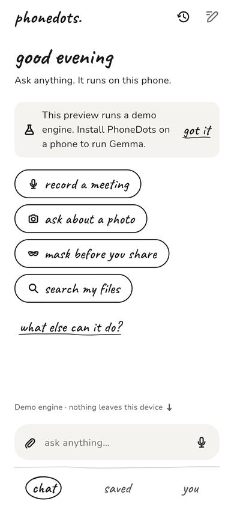
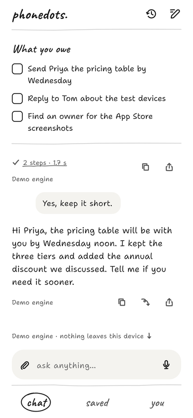
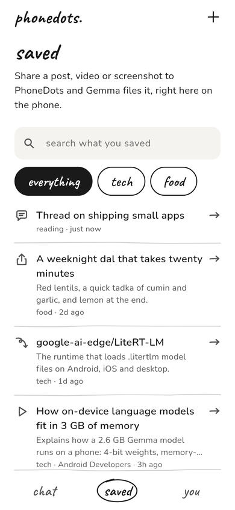
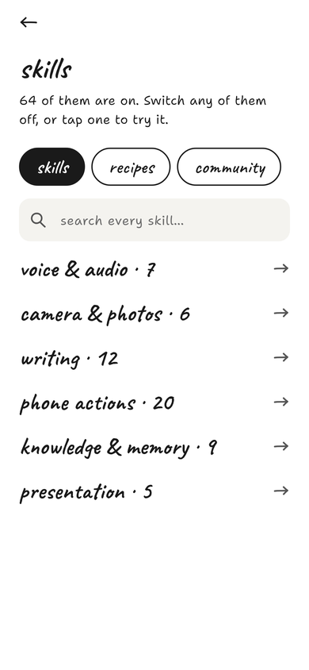
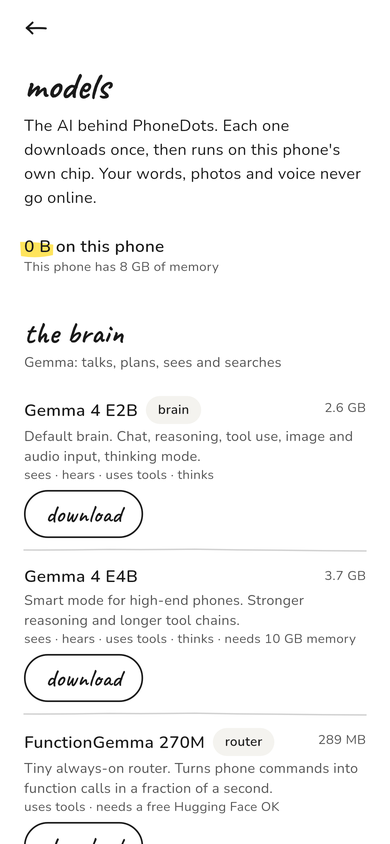
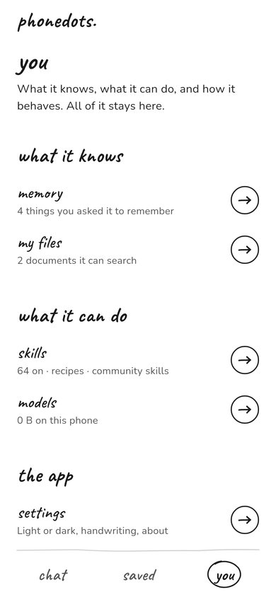
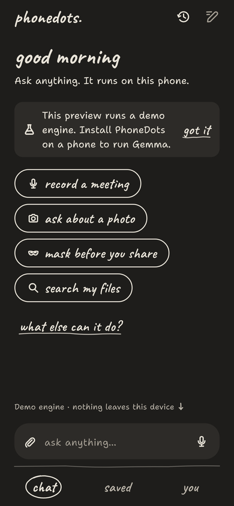
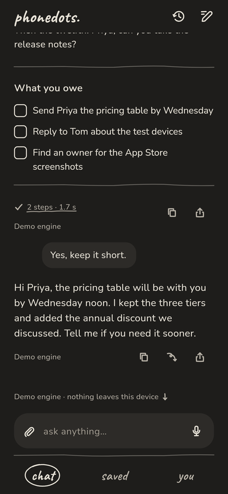

# PhoneDots

**An AI assistant that runs entirely on your phone.** Google's Gemma models are the brain, Desert Ant's specialist models are the hands, and *skills* connect them to your phone, your files and each other. No account, no cloud, and it works in airplane mode.

Flutter app for Android, iOS and macOS, with native bridges to [LiteRT-LM](https://github.com/google-ai-edge/LiteRT-LM) and [desert-ant-core](https://github.com/Desert-Ant-Labs/desert-ant-core). Inspired by [Google AI Edge Gallery](https://github.com/google-ai-edge/gallery).

<p>




</p>
<p>





</p>

*Screenshots from the demo engine (the web and desktop preview).*

## Look and feel

PhoneDots uses **Burrow's "hand-drawn minimal" design system** (from [Android-Showcase](https://github.com/Shashank2577/Android-Showcase), `design/burrow-a/theme`), in its readable form (tokens 2.0.0, baseApp `design/REVIEW.md`):

- White paper and ink (a warm "night notebook" in dark mode), one marker-yellow swipe per screen on a fact, and red pen only for destructive things and the `!` in front of a warning.
- **Two styles, one choice in settings: handwritten or formal.** *Handwritten* is the default: titles, names, tags and remembered facts are hand-lettered in Caveat (24 for a row title, 30 for a content title, 18 for a tag), and the text you read is in a hand voice: Shantell Sans "neat hand" by default, "loose hand", or Patrick Hand ("all handwritten"). *Formal* sets everything you read, titles and tags included, in a plain sans (Nunito "friendly" or Inter "formal") and keeps Caveat for the app's own short words only. Page titles, section heads, buttons, links and the tab words are Caveat in both.
- Sentences are ink; pencil grey is only for short meta lines and captions; nothing readable is under 13. Long text (answers, summaries) is 17/26 and never wider than 600.
- No cards: content sits on the paper, separated by wobbly hairlines. Pages open with a name and one sentence; "doors" with circled arrows lead to places in the app, plain rows with a small arrow open content.
- One ink pill per screen for the main action; outlined pills and underlined links for the rest; every target is at least 48 dp. A disabled button is a smudge pill with a graphite label, never a faded one.
- Calm motion: a light squish and haptic tick on press, rows rising in as they scroll into view, the nav ring drawing itself, ticks drawing on.

Tokens and type roles live in `lib/theme/theme.dart` (`context.type.reading`, `.rowTitle`, `.body`, `.meta`, `.caption`, …; `TypeRoles.of` is the one place that picks Caveat or the plain face for a role, from the voice), components in `lib/widgets/hand.dart` (`ItemRow`, `Door`, `PageIntro`, `InkButton`, …) and long text in `lib/widgets/rich_text.dart` (`Prose`).

## What's new

**0.9.1.** The handwritten fonts are back, and they are the default: the neat, loose and all-handwritten voices, with hand-lettered titles, names and tags, as before 0.9.0. Settings has one choice, *handwritten or formal*; formal is the plain-font look 0.9.0 introduced. The layout, spacing, larger sizes and darker text of 0.9.0 stay. 0.9.0 switched every install to Nunito; an install that ran 0.9.0 goes back to the neat hand once, an install coming straight from 0.8.0 or earlier keeps the voice it had, and after that your choice stays.

**0.9.0.** Three tabs (chat · saved · you), a rail on wide windows, answers first with steps folded away, 48 dp targets, larger text and darker greys.

## Screens

Three words along the bottom: **chat · saved · you**. Skills and models are things you set up, so they live under "you". On a window 1000 or more wide (a Mac) the same words are a rail on the left, with settings and privacy at its foot, and pages sit beside it.

| Screen | What it is for | Main action |
|---|---|---|
| **chat** | Ask anything. Empty: a greeting, four suggestions (record a meeting, ask about a photo, mask before you share, search my files) and "what else can it do?" (skills). In a conversation the answer comes first; thinking and skill steps fold into one line under it ("2 steps · 1.7 s") that opens the trace. The model line above the composer opens the model picker. | The composer: the mic when it's empty (voice mode), send when you've typed |
| past chats (the clock, top right) | Carry on an old chat, copy this one, start a new one | Pick a chat |
| **saved** | Everything shared into PhoneDots: title, summary and source per row, filters on one line. A post opens with its summary first, key points, tags, and "what we read" (the raw text) behind a link. | "open the original" |
| **you** | Three groups: *what it knows* (memory, my files), *what it can do* (skills, models), *the app* (settings, privacy, under the hood) | Doors to each |
| memory | The facts you asked it to remember, in your words | "remember something" |
| my files | Notes and imports it can search | Search |
| skills | Skills in folded groups ("writing · 12") with a switch each, recipes and community skills | Tap a skill to try it |
| models | Each model with its name, size, what it does and its state on its own line; "download all" when many are missing | Download |
| settings | Light or dark, handwritten or formal (two pills, then that style's voices, each with a live sample), the assistant, saved posts, keys, and about with the licences | — |
| privacy | What is kept, a "forget" link per kind of data, and every action it took | — |
| under the hood | Diagnostics (the log, crash reports) and the lab (prompt lab, speed test) | Share the log / run |

## What it does

| | |
|---|---|
| **Chat** | Gemma 4 E2B/E4B with streaming, thinking mode, images and short audio clips as input |
| **Agent** | Gemma plans and calls skills in a bounded loop. FunctionGemma 270M is a fast path for simple phone commands. |
| **58 skills** | Audio (transcribe, speakers, minutes, subtitles, clean-up), vision (ask, OCR, tags, best shot, safety, receipts), writing (summarize, rewrite, translate, redact, emoji, topics, titles), phone actions (timer, alarm, calendar, contacts, call/text/email drafts, maps, flashlight, settings), knowledge (search my files, memory, exact maths, units, dates), presentation (tables, checklists, charts, timelines, notes) |
| **Recipes** | Chain skills into one tap. Five built in, plus an editor. The agent can run them too. |
| **Community skills** | Install declarative JSON skills from a URL. They can't run code (see [docs/COMMUNITY_SKILLS.md](docs/COMMUNITY_SKILLS.md)). |
| **Voice mode** | Hands-free, turn by turn: it listens until you pause, answers out loud sentence by sentence, then listens again; talk over it to interrupt (echo-cancelled mic). Voz writes down what you say. Natural on-device voices with Kyutai's Pocket TTS (sherpa-onnx): listen to a voice, then download it (~1 MB). Expressive voices speak each sentence in the mood Gemma tags it with (happy, calm, whisper, laughing, sympathetic…), and a hand-drawn face shows it. Donated voices are CC0; mood voices (Expresso) are personal-use only. |
| **My files** | On-device search index (EmbeddingGemma, or keyword fallback) over notes, imports, receipts and transcripts |
| **Memory** | Facts you explicitly ask it to remember, fully visible and editable |
| **Model hub** | One shared model store for every app of the vendor (one download per device), resume and SHA-256 verification, RAM-fit warnings, choice of brain/router/embedder |
| **Lab** | Prompt Lab and an on-device benchmark (tok/s, time to first token) |
| **Saved** | Share a reel, Short, video, post, repo, article or screenshot from any app. Gemma summarises it on the phone, giving a summary, key points, a collection and tags, and keeps the whole text. Each site's own free channel is used: YouTube's watch page (full description, chapters, tags) or the YouTube Data API with a free key; GitHub README; Medium RSS (full free articles); Threads and X oEmbed; Instagram, TikTok and LinkedIn captions from their embeds and preview tags. A screen-recorded reel becomes a contact sheet of frames for Gemma plus a Voz transcript. Optional Jina Reader fallback for open pages. Login walls and bot checks are respected. No per-post cost, no daily cap. |
| **Privacy** | A ledger of every action, including every link that was read and where it was sent |
| **Share sheet** | "Share to PhoneDots" from any app on Android. Links, images and clips go to Saved; plain text opens a chat. |

## Architecture

```
Surfaces    chat · saved · you (memory, files, skills, models, settings, privacy, diagnostics, lab) · voice · share sheet
   │
Agent       lib/agent/agent.dart
            FunctionGemma router (fast path) → Gemma planner tool loop → permission gate → skills
   │
Skills      lib/skills/  built-in (audio, vision, text, phone, knowledge, output) · recipes · community
   │
Engines     lib/core/runtime/engines.dart (interfaces)
            ├─ platform_engines.dart  → MethodChannels → Kotlin / Swift bridges
            └─ demo_engines.dart      → web/desktop preview and tests (always labelled "Demo")
   │
Native      android/…/LlmBridge.kt        LiteRT-LM 0.19 (Gemma, tool calling, embeddings)
            android/…/SpecialistBridge.kt desert-ant-core 4.2.1 Android SDK
            android/…/DeviceBridge.kt     intents, calendar, contacts, torch, volume
            ios/Runner/*Bridge.swift      LiteRTLM + Desert Ant Swift packages, EventKit, Contacts
```

The channel contract is documented in [docs/NATIVE_BRIDGE.md](docs/NATIVE_BRIDGE.md). The product spec is in [docs/PRODUCT_SPEC.md](docs/PRODUCT_SPEC.md).

### Models

| Model | Role | Download |
|---|---|---|
| Gemma 4 E2B | Brain (default) | 2.6 GB, `litert-community/gemma-4-E2B-it-litert-lm` |
| Gemma 4 E4B | Brain (high-end phones) | 3.7 GB |
| FunctionGemma 270M (mobile actions) | Fast router | 289 MB |
| Gemma 3 270M | Brain for low-memory phones | 304 MB |
| EmbeddingGemma 2 (text / text+vision) | Search | 165 MB / 388 MB |
| Desert Ant: Voz, Who, Ear, Clear, Redact, Tongue, Emo, Gist, Eye, Moderator, Shapes | Specialists, Android + iOS | 1 MB – 470 MB each |
| Desert Ant: Uhm, Align, Title, Clips | Specialists, iOS only | |

Gemma files and checksums are pinned in `lib/core/models/model_catalog.dart`, and match the base platform's shared catalog (a test checks this). The Desert Ant SDK downloads and verifies its own weights.

**One download per device.** Models live in the base platform's shared model store (`base_models`, synced from baseApp into `packages/base_models`), not in PhoneDots' own folder:

- **iOS:** one folder in the App Group `group.com.showcase.shared`, used in place by every app of the vendor. Your Apple team needs that App Group; without it PhoneDots keeps its models to itself.
- **Android:** each app keeps its own copy, and copies a model from a sibling app that has it instead of downloading it (the models page offers "copy, no download"). Siblings must be signed with the same key. Desert Ant weights go to `<store>/desertant.<key>`.
- A model is deleted only when the last app using it lets go. Models downloaded by an older PhoneDots move into the store on first start, without downloading again.

## Run it

Requirements: Flutter 3.47+ (Dart 3.13).

```bash
flutter pub get
```

```bash
flutter test
```

```bash
flutter run -d chrome
```

The web/desktop build runs the **demo engine**: the full UI and the skill system work, and model output is scripted and clearly labelled. Real inference needs a phone.

**Android** (API 26+, arm64; 8 GB RAM recommended for Gemma 4 E2B):

```bash
flutter run -d <android-device> --release
```

**Test builds (APK).** Every push builds one: Actions → the run → Artifacts → `phonedots-apk`. Tagged builds (`v*`) go to Releases. Every build, debug and release, is signed with the vendor's public test key (`android/app/phonedots-test.jks`, the same key Burrow uses and baseApp keeps as `signing/showcase-test.jks`), so a new build updates in place over an older one and PhoneDots and Burrow share downloaded models. Earlier PhoneDots test builds used this same key, so they update in place too. Publishing to a store needs your own key: see baseApp `signing/README.md` (no developer account needed to make one); CI uses it once the `ANDROID_KEYSTORE_*` secrets exist.

**Reporting a problem.** You → under the hood → diagnostics shows each step with your models (download or copy from another app, HTTP status, checksum, load time), model and skill timings, and every error or crash. Tap **copy** (or **share the log**) and paste it into the report.

**iPhone and Mac test builds.** Every release also has an unsigned iPhone app (`-ios-unsigned.ipa`) and a Mac app (`-macos.zip`), built on GitHub's macOS runners:

- **iPhone (iOS 18+):** install the .ipa yourself with [Sideloadly](https://sideloadly.io) or [AltStore](https://altstore.io) and a free Apple ID, then trust your Apple ID on the iPhone (Settings → General → VPN & Device Management). A free Apple ID's signature lasts 7 days, so install it again after that. Without a paid Apple Developer account the app can't join the shared App Group, so it keeps its own models instead of sharing them with your other apps.
- **Mac (macOS 14+, Apple silicon):** unzip, move PhoneDots to Applications, and the first time right-click → Open (it isn't notarised), or run `xattr -dr com.apple.quarantine /Applications/PhoneDots.app`. Flashlight and battery skills don't exist on a Mac; sharing copies to the clipboard.

**Building for iOS or macOS yourself** (Xcode 26): nothing to add by hand. The bridges are the `phonedots_native` plugin (`packages/phonedots_native`), whose Swift package pulls in LiteRT-LM and desert-ant-core; see [docs/IOS_SETUP.md](docs/IOS_SETUP.md).

```bash
flutter config --enable-swift-package-manager
flutter run -d <iphone-or-macos> --release
```

## Status

| Area | State |
|---|---|
| Dart app, agent, skills, UI | Done. `flutter analyze` is clean and about 930 tests pass (unit, end-to-end agent loop, widget, layout sweeps). |
| Android native bridge | Builds into an APK (`flutter build apk`) against LiteRT-LM 0.19.0 and desert-ant-core 4.2.1. Not yet run on a physical device. Both SDKs ship `libLiteRt.so` and the APK keeps one copy, so check on a device that Gemma and the specialists both load. If they don't, align the LiteRT versions. |
| iOS and macOS native bridges | `packages/phonedots_native`, shared by both. Built on GitHub's macOS runners for every release (unsigned). Not yet run on a physical iPhone or Mac. |
| Share extension on iOS | Not built. Android share intake works. |

## Licences

App code: see repository. Gemma models: [Gemma Terms of Use](https://ai.google.dev/gemma/terms). Desert Ant models: free up to 100k monthly active devices; Voz weights (NVIDIA Parakeet TDT 0.6B v3) under CC BY 4.0. LiteRT-LM and Edge Gallery: Apache 2.0.
